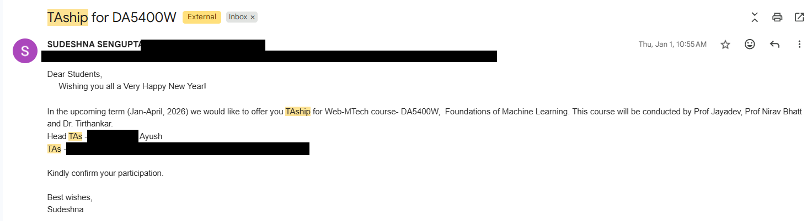
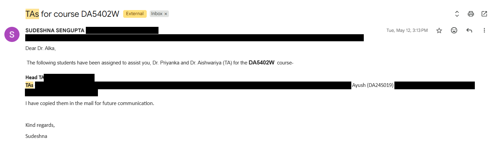
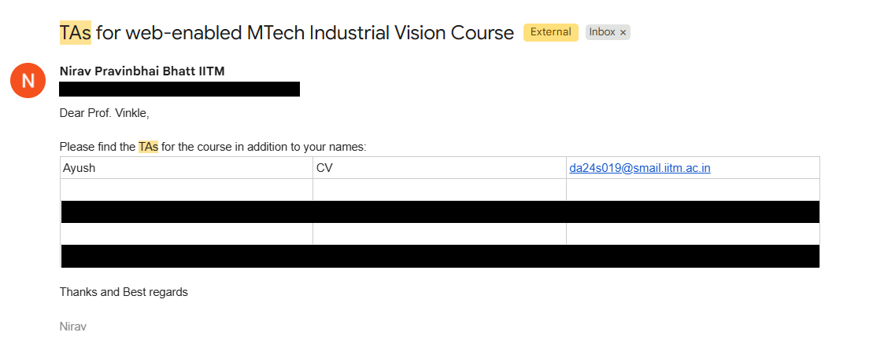

# Teaching Assistantship — Evidence

Ayush Kumar (DA24S019), MS by Research, Data Science & AI, IIT Madras.

TA assignments for the **Web-enabled M.Tech programme, IIT Madras**, shown by the official
assignment emails below. Other students' names and all email addresses have been redacted.

| Course | Role | Term | Evidence |
|---|---|---|---|
| DA5400W — Foundations of Machine Learning | Head TA | Jan–Apr 2026 | [Email](DA5400W_Foundations_of_ML_Head_TA.png) |
| DA5402W — Data Analytics & MLOps | TA | May 2026 | [Email](DA5402W_TA.png) |
| Industrial Vision | TA | — | [Email](Industrial_Vision_TA.png) |

### DA5400W — Foundations of Machine Learning (Head TA)

### DA5402W — Data Analytics & MLOps (TA)

### Industrial Vision (TA)

